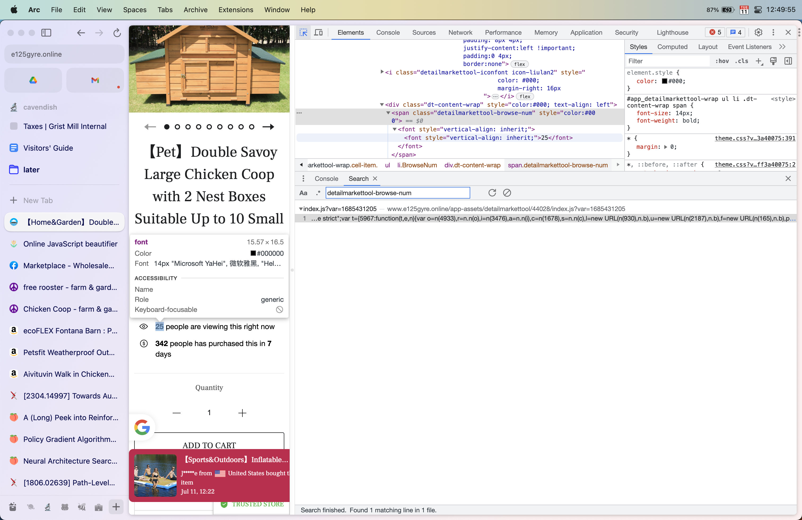
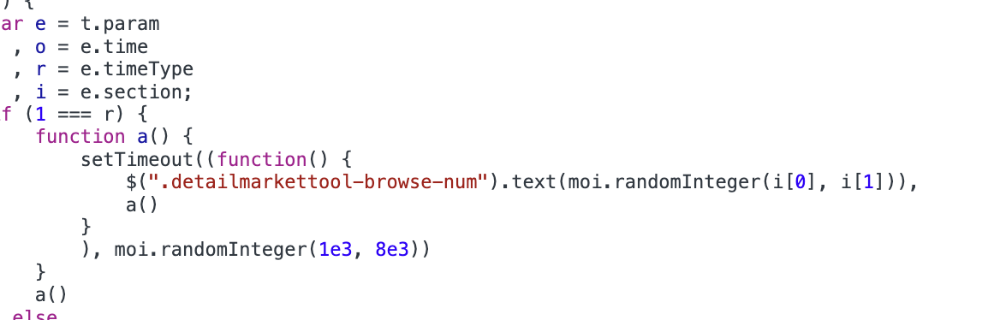

+++
title = "Hilarious Random Number Generator"
date = 2023-07-18
rss = ""
tags = []
descr = true
githubsource = "https://github.com/jasoneveleth/blog/blob/dev/2023/07/18/chicken-coop-website.md"
+++
@@toc@@

I was searching for a chicken coop (as one does). I stumbled across a Facebook marketplace ad:

@@im-most

@@

The website it linked to had a live updating "people viewing this item" count:

@@im-most

@@

That seemed suspicious, so I looked into it.

@@im-most

@@

@@im-most

@@

They were just setting a random integer with jquery on a `setTimeout()`.

@@comments@@
